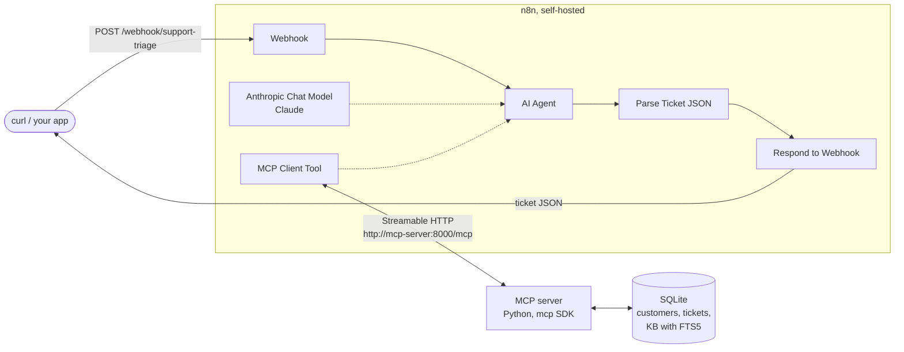

# n8n + Claude + MCP: support triage

A self-hosted n8n workflow where a Claude agent triages support requests by calling tools on a custom Python MCP server.



<!-- Screenshot: open the workflow in n8n, capture the canvas, save it as docs/workflow.png and uncomment the line below. -->
<!--  -->


A support request (name, email, subject, body) comes in. The agent looks up the customer, searches a small knowledge base, picks a category and priority, drafts a reply and files a ticket. The workflow returns the ticket as JSON.


## Run it in 5 minutes

You need Docker with Compose and an [Anthropic API key](https://console.anthropic.com/).

```bash
git clone https://github.com/MStanislavov/n8n-claude-mcp-support-triage.git
cd n8n-claude-mcp-support-triage
cp .env.example .env        # then set ANTHROPIC_API_KEY in .env
docker compose up -d
make smoke
```

That is the whole setup. A one-shot `n8n-init` container imports the Anthropic credential (built from `ANTHROPIC_API_KEY`) and the workflow, then publishes it before n8n starts. No generated credential file is written to the repo.

- The n8n editor is at http://localhost:5678. On the first visit n8n asks you to create a local owner account. The workflow "Support triage (Claude + MCP)" is already there.
- `ANTHROPIC_MODEL` in `.env` sets the model. The default is `claude-sonnet-5-5`.
- After changing `.env`, run `docker compose up -d` again. `n8n-init` runs again and re-imports the workflow and credential.
- If port 8000 or 5678 is taken on your machine, set `MCP_HOST_PORT` or `N8N_HOST_PORT` in `.env`. These only change the host side of the port mapping. If you change `N8N_HOST_PORT`, run the smoke script as `N8N_URL=http://localhost:<port> make smoke`.

To send a single request:

```bash
curl -s -X POST localhost:5678/webhook/support-triage \
  -H 'Content-Type: application/json' -d @samples/02-outage-report.json
```

## Sample input and output

Input (`samples/02-outage-report.json`):

```json
{
  "name": "Marcus Oliveira",
  "email": "marcus.oliveira@example.com",
  "subject": "EVERYTHING IS DOWN AGAIN",
  "body": "This is the second time this year. Since 08:10 CET none of our 60 people can open a single board, we just get a spinner and then \"Workspace unavailable\". We pay for Business with an SLA. I need someone on this right now and I want to know what you are doing about credits."
}
```

Output:

<!-- TODO: paste real output from make smoke -->

Output will be added after a real smoke run. `make smoke` posts all four files in `samples/` (a billing question, an outage report, a feature request and a request from an unknown email address) and pretty-prints each ticket.

## How it works

### Workflow nodes

The workflow is in [`workflows/support-triage.json`](workflows/support-triage.json).

| Node | What it does |
|---|---|
| Webhook | `POST /webhook/support-triage`. Replies through the Respond to Webhook node. |
| AI Agent | Runs the agent loop. The system prompt makes it call `lookup_customer` and `search_kb` before `create_ticket`, and return one strict JSON object. |
| Anthropic Chat Model | The Claude model. The id comes from `ANTHROPIC_MODEL` and is written into the workflow when `n8n-init` imports it. |
| MCP Client Tool | Connects to `http://mcp-server:8000/mcp` over Streamable HTTP and exposes all three tools to the agent. |
| Parse Ticket JSON | A Code node that strips markdown fences, if any, and parses the agent's reply. |
| Respond to Webhook | Returns the ticket JSON with status 200. |

n8n does not expose environment variables to workflow expressions by default, which is why the model id is written at import time instead of read with `$env`.

### MCP tools

The server is in [`mcp-server/`](mcp-server/). It uses SQLite, seeded on first start with 5 demo customers and 7 past tickets. The 10 knowledge-base articles in `mcp-server/kb/` are indexed with FTS5 on every start.

| Tool | Arguments | Returns |
|---|---|---|
| `lookup_customer` | `email` | Plan, account age, open ticket count and recent ticket subjects. `found: false` for unknown senders. |
| `search_kb` | `query`, `limit` (1 to 5, default 3) | Ranked articles with slug, title, body and score. |
| `create_ticket` | `customer_email`, `category`, `priority`, `summary`, `suggested_reply` | The new `ticket_id`. |

`category` is one of `billing`, `technical`, `outage`, `feature_request`, `account`, `other`. `priority` is one of `low`, `normal`, `high`, `urgent`. Both are validated against fixed enums. The tool descriptions in [`server.py`](mcp-server/support_mcp/server.py) are what the agent reads.

### Why MCP

The tools live outside n8n. The same server works from Claude Code, Claude Desktop or any other MCP client without touching the workflow:

```bash
claude mcp add --transport http support-triage http://localhost:8000/mcp
```

You can also call it directly:

```bash
curl -s localhost:8000/mcp \
  -H 'Content-Type: application/json' -H 'Accept: application/json, text/event-stream' \
  -d '{"jsonrpc":"2.0","id":1,"method":"tools/list"}' | python3 -m json.tool
```

The server is built on `mcp` 2.x, where `FastMCP` is now called `MCPServer` (`from mcp.server.mcpserver import MCPServer`). It runs in stateless JSON mode, so each request stands alone.

### Tests

`make test` runs pytest against a temporary SQLite database. It covers all three tools, both directly and through an in-process MCP client. It needs neither Docker nor an API key.

### Make targets

| Target | What it does |
|---|---|
| `make up` | Build and start the stack. |
| `make down` | Stop and remove the containers. Data volumes are kept. |
| `make logs` | Follow the logs. |
| `make smoke` | Post the four sample requests and print the tickets. |
| `make test` | Run the MCP server tests. |
| `make reset` | Stop everything and delete the volumes (n8n data and the SQLite database). |

## Production notes

This is a demo. The gap between it and a production deployment:

- Authenticate the webhook (header auth or an HMAC signature) and rate limit it.
- Run n8n in queue mode with Redis and workers, and use Postgres instead of SQLite for n8n itself.
- Add retries and a dead-letter path for failed agent runs, and validate the agent's JSON against a schema instead of only parsing it.
- Add observability: ship n8n execution logs out, add structured logs and metrics to the MCP server, and track token use and cost.
- Put authentication on the MCP server and keep it off public networks.
- Replace SQLite with a real helpdesk API (Zendesk, Freshdesk, Jira Service Management) behind `create_ticket` and a real CRM behind `lookup_customer`.
- Load secrets from a secret manager instead of `.env`.
- Have a person review replies before they are sent to customers.

## Author

Mile Stanislavov: [mstanislavov.com](https://mstanislavov.com) | [github.com/MStanislavov](https://github.com/MStanislavov)

License: MIT
